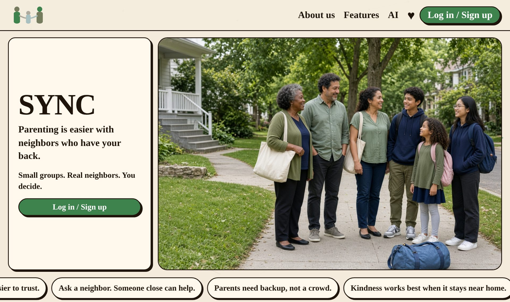
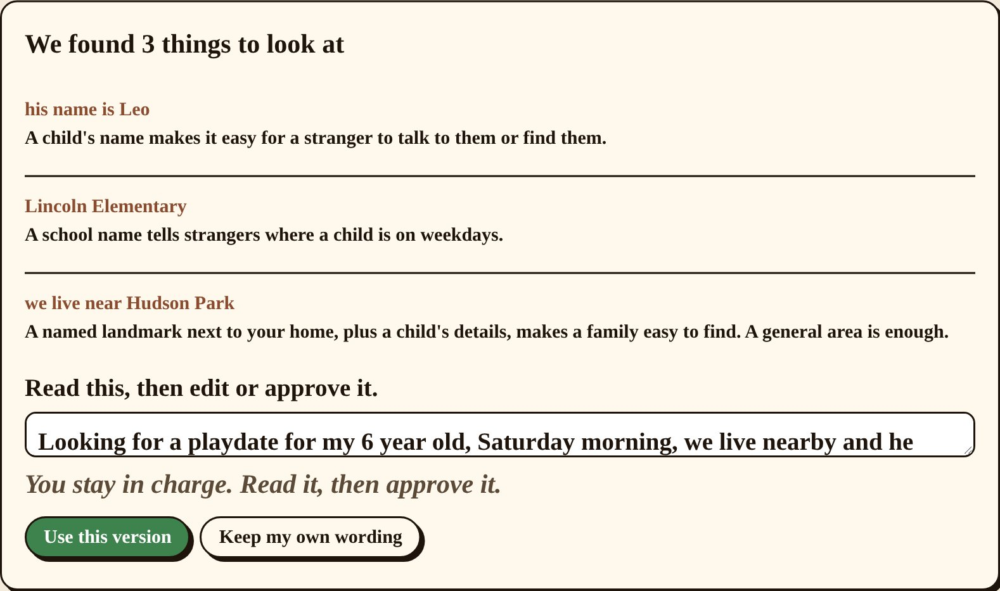
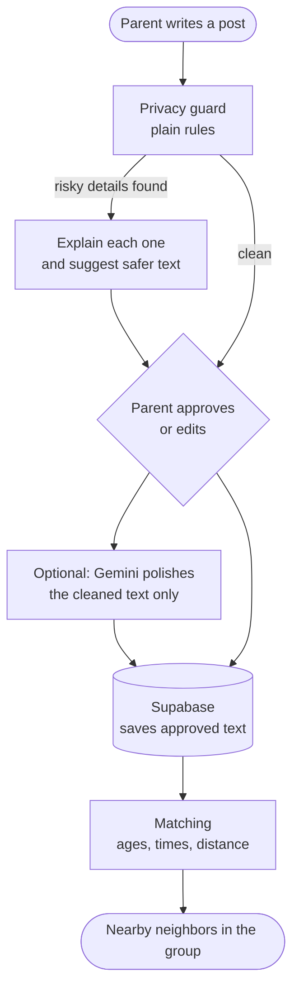

# Sync


**A safe way for parents to get help from nearby families.** Small invite only groups, no public feed, no likes, no public profiles. Before anything is posted, Sync checks for details that could point a stranger to a child or a home, explains why, and offers a safer version. People make every decision.

Built for **Hacks for Humanity 2026** (ASU Project Humanities), Parenting track.



## The Problem

Parents need small favors all the time: a school pickup, a playdate, someone to watch the kids for an hour. The neighbors who could help are right there, but the apps built for neighbors are public feeds full of arguments, and parents end up oversharing. A post like *"his name is Leo and he goes to Lincoln Elementary, we live near Hudson Park"* tells a stranger exactly where to find a child.

Sync keeps help local and private: you join a small group through someone you know, and every post goes through a privacy check before anyone sees it.

## The Privacy Guard in Action



The guard flagged the child's name, the school and the landmark near home, explained the risk of each one, and rewrote the post as *"Looking for a playdate for my 6 year old, Saturday morning, we live nearby and he goes to school."* The parent chooses the safer version or edits their own.

## Features

- **Kid Privacy Guard:** catches children's names, schools, addresses, landmarks near home, phone numbers, emails, daily routines, appearance details and money talk. Only the cleaned, approved text is ever saved.
- **Invite only groups:** join with a short code handed out in person or on a flyer, not a link. Codes expire, have a use limit, and lock after 5 wrong tries.
- **Groups that grow with trust:** a group starts at 25 members and can grow to 60, then 150, only after neighbors have actually helped each other.
- **Nearby matching with plain reasons:** needs and offers are matched by kids' ages, free times, distance (1 mile max) and comfort preferences. Nobody is scored or ranked.
- **Group tabs:** Help, Calendar (free times and pickup conflicts), Gather (playdates and events), Discussion Forum, Street updates and Rewards (thank you notes and badges).
- **Trust in steps:** badges like "Invited by Maya" or "Helped neighbors" are earned through real activity, and the app never claims to verify anyone.
- **Voice requests:** speak a request, and it's transcribed and tidied up (filler words and repeats removed). It still goes through the privacy guard before posting.
- **Email code login** with Supabase Auth, plus an admin page for reports.

## Tech Stack

| Layer | Technology |
|---|---|
| Frontend | Next.js 16 (App Router), React 19, TypeScript |
| Backend | Next.js route handlers and server actions |
| Database and auth | Supabase (Postgres with row level security, email code login) |
| Optional AI | Google Gemini (rewrites already cleaned text), ElevenLabs (speech to text) |
| Tests | Node test runner with `tsx` |

## How It Works



## Key Decisions

- **The guard is plain rules, not AI.** It gives the same result every time, works with no API keys, and can be tested. 45 tests cover the guard, matching, group rules, badges and login.
- **AI never sees the original post.** Gemini only gets text the rules have already cleaned. If the key is missing, wrong or rate limited, the app quietly falls back to the rule based version.
- **Only approved text is stored.** The original post with a child's details never reaches the database.
- **Row level security on every table.** All 16 tables in `supabase/schema.sql` have RLS turned on, so members only read data from their own groups.
- **Codes instead of links.** An invite link can be forwarded anywhere. A short code handed out in person keeps groups to people who actually live nearby.
- **No scores or rankings.** Matches come with plain reasons, like shared free times and close ages, so no parent feels judged or ranked.

## Run It Locally

You need Node 20+ and a free [Supabase](https://supabase.com) project.

```bash
git clone https://github.com/manaswichowdary/Sync.git
cd Sync
npm install
cp .env.example .env.local
```

1. In Supabase, open the SQL editor and run `supabase/schema.sql`.
2. Fill in `SUPABASE_URL`, `SUPABASE_ANON_KEY` and `SUPABASE_SERVICE_ROLE_KEY` in `.env.local`.
3. Optional: add `GEMINI_API_KEY` ([free key](https://aistudio.google.com/apikey)) and `ELEVENLABS_API_KEY` for voice.

```bash
npm run seed       # demo groups, neighbors and posts
npm run dev        # open http://localhost:3000
npm test           # run the 45 tests
```

`npm run reset-demo` puts the demo data back to its starting state.

## Project Layout

```
app/          Pages (home, group, post, login, start, safety, admin) and API routes
components/   UI panels for each group tab, header, badges, voice button
lib/          Privacy guard, matching, group rules, badges, forecast, Supabase data layer
supabase/     Database schema with row level security
scripts/      Seed and reset scripts for demo data
```

## My Role

I built the app end to end: the privacy guard, matching, group rules, database schema, login and every page.
